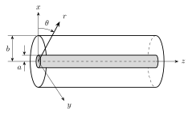
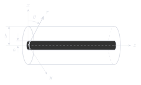

# 東大理物 令和2年度 物理学 第3問：同軸ケーブル中の電磁波とTEMモード

## 問題

同軸ケーブル中の電磁波の伝搬について考える。同軸ケーブルは図1に示すように，半径 $a$ の円柱芯線と中心軸を同じにして外側にある内半径 $b$ の円筒状導体から構成されている。円柱と円筒の間の空間は，誘電率 $\epsilon$，透磁率 $\mu$ の絶縁体で満たされているとする。外側の円筒の厚さは十分薄く，同軸ケーブルの長さは半径に比べて十分長く，かつ直線状であるとする。芯線および円筒状導体の電気抵抗は無視できるものとする。

同軸ケーブルに沿った方向を $z$ 軸とし，電場，磁場ともに $z$ 軸に平行な成分を持たない軸対称な伝搬モード（以下，TEM モードと呼ぶ）について考える。$\epsilon$ と $\mu$ は定数とする。絶縁体中の電磁波は Maxwell 方程式

$$
\begin{aligned}
\nabla \times \boldsymbol{E} &= -\frac{\partial\boldsymbol{B}}{\partial t} \\
\nabla \times \boldsymbol{B} &= \mu\epsilon\frac{\partial\boldsymbol{E}}{\partial t} \\
\nabla \cdot \boldsymbol{B} &= 0 \\
\nabla \cdot \boldsymbol{E} &= 0
\end{aligned}
$$

（上から順に式 (1)，(2)，(3)，(4) とする）に従う。ここで $\boldsymbol{E}$ は電場，$\boldsymbol{B}$ は磁束密度である。以下，図1に示す円筒座標系 $(r, \theta, z)$ で考えることとする。任意の関数 $f$，ベクトル $\boldsymbol{A}$ に対する円筒座標系での勾配，発散，回転はそれぞれ

$$
\begin{aligned}
\nabla f &= \frac{\partial f}{\partial r}\mathbf{e}_r + \frac{1}{r}\frac{\partial f}{\partial\theta}\mathbf{e}_\theta + \frac{\partial f}{\partial z}\mathbf{e}_z \\
\nabla\cdot\boldsymbol{A} &= \frac{1}{r}\left[\frac{\partial}{\partial r}(r A_r) + \frac{\partial A_\theta}{\partial\theta} + r\frac{\partial A_z}{\partial z}\right] \\
\nabla\times\boldsymbol{A} &= \left[\frac{1}{r}\frac{\partial A_z}{\partial\theta} - \frac{\partial A_\theta}{\partial z}\right]\mathbf{e}_r + \left[\frac{\partial A_r}{\partial z} - \frac{\partial A_z}{\partial r}\right]\mathbf{e}_\theta + \frac{1}{r}\left[\frac{\partial}{\partial r}(r A_\theta) - \frac{\partial A_r}{\partial\theta}\right]\mathbf{e}_z
\end{aligned}
$$

で与えられる。$\mathbf{e}_r,\ \mathbf{e}_\theta,\ \mathbf{e}_z$ はそれぞれ $r, \theta, z$ 方向の単位ベクトルである。以下の設問に答えよ。

<figure class="figure" markdown="0">
  
  
  <figcaption>図1：半径 $a$ の円柱芯線と内半径 $b$ の円筒状導体からなる同軸ケーブルおよび円筒座標系 $(r, \theta, z)$。</figcaption>
</figure>

1. この TEM モードの磁束密度の $r$ 方向成分 $B_r$，電場の $\theta$ 方向成分 $E_\theta$ はともにゼロとなることを示せ。
2. $E_r(r, z, t)$ に対する波動方程式を求めよ。
3. $z$ 方向の波数を $k$，角周波数を $\omega$ として，電場および磁束密度を複素表示でそれぞれ

$$
E_r(r, z, t) = \mathcal{E}(r) e^{ikz - i\omega t},\qquad B_\theta(r, z, t) = \mathcal{B}(r) e^{ikz - i\omega t}
$$

と記述する。$\mathcal{E}(r = a) = E_0$ としたとき，$\mathcal{E}(r)$ を求めよ。

4. 同軸ケーブルを伝搬する電磁波の位相速度を求めよ。
5. 同軸ケーブル断面を通過する単位時間あたりの電磁波のエネルギーを求めよ。
6. 位置 $z$，時刻 $t$ における円筒状導体に対する芯線の電圧 $V(z, t)$ を求めよ。
7. 設問6で求めた電圧 $V$ と，芯線を流れる電流 $I$ の比 $V(z, t)/I(z, t)$ は特性インピーダンス $Z_0$ と呼ばれる。$Z_0$ を求めよ。

次に，同軸ケーブルを伝搬するパルスを考える。その電圧を $V(z, t)$ で表す。以下，$\epsilon$ および $\mu$ は周波数の関数であり，$\omega$ は波数 $k$ の関数とする。$V(z, t)$ の複素表示を波数 $k$ の波の重ね合わせとして

$$
V(z, t) = \frac{1}{\sqrt{2\pi}}\int_{-\infty}^{\infty} v(k) e^{ikz - i\omega(k)t}\,dk
$$

と表す。

8. $v(k)$ がある波数 $k_0$ を中心とする狭い範囲でのみ $0$ でない値をとり，$\omega(k)$ が定数 $A$ を用いて

$$
\omega(k) = \omega(k_0) + A(k - k_0)
$$

と近似できるとき，複素表示での電圧パルスの振幅 $|V(z, t)|$ は，その波形を変えずに同軸ケーブル中を伝搬することを示せ。

> 出典：東京大学大学院理学系研究科物理学専攻 令和2年度修士課程入学試験 物理学 第3問（引用元：<https://www.phys.s.u-tokyo.ac.jp/>）。Web掲載にあたり数式をテキスト化し，図を描き直しています。解答・解説は当サイトが独自に作成したもので，東京大学が公表したものではありません。

## 解答・解説

軸対称かつ $z$ 成分のない TEM モードでは，円筒座標系のマクスウェル方程式と完全導体表面での境界条件によって，動径方向と軸方向の変化が分離されます。断面内では静電場・静磁場と同じ $1/r$ 型の場が形成される一方，軸方向には自由空間の平面波と同じ1次元波動方程式に従います。

この構造により，電場から電圧 $V$ を，磁場からアンペールの法則で電流 $I$ を直接求めることができ，両者の比として幾何形状と媒質定数だけで決まる特性インピーダンス $Z_0$ が導かれます。

### (1)
TEM モードの仮定より $E_z = 0,\ B_z = 0$，軸対称性より $\dfrac{\partial}{\partial\theta} = 0$ です。

まず式 (3) $\nabla\cdot\boldsymbol{B} = 0$ を円筒座標系で書き下します。

$$
\frac{1}{r}\frac{\partial}{\partial r}(r B_r) = 0 \implies r B_r = f(z, t)
$$

ここで $f(z, t)$ は $r$ によらない関数です。電気抵抗のない完全導体内部では磁束密度は $0$ であり，導体表面における磁束密度の法線成分は連続なので，$r = a$（および $r = b$）で $B_r = 0$ となります。これより $f(z, t) = a B_r(a, z, t) = 0$ となり，絶縁体中のすべての $r\ (a < r < b)$ で $B_r = 0$ が成り立ちます。

次に式 (1) $\nabla\times\boldsymbol{E} = -\dfrac{\partial\boldsymbol{B}}{\partial t}$ の $z$ 成分を書き下します。$B_z = 0$ かつ $\dfrac{\partial}{\partial\theta} = 0$ より，

$$
\frac{1}{r}\frac{\partial}{\partial r}(r E_\theta) = 0 \implies r E_\theta = g(z, t)
$$

となります。完全導体表面では電場の接線成分が $0$ であることから $r = a$ で $E_\theta = 0$ なので，$g(z, t) = a E_\theta(a, z, t) = 0$ となり，すべての $r\ (a < r < b)$ で $E_\theta = 0$ が成り立ちます。

### (2)
問1より，0でない電磁場成分は $E_r(r, z, t)$ と $B_\theta(r, z, t)$ のみです。式 (1) の $\theta$ 成分と式 (2) の $r$ 成分を円筒座標系で書き下します。

$$
\frac{\partial E_r}{\partial z} = -\frac{\partial B_\theta}{\partial t}, \qquad -\frac{\partial B_\theta}{\partial z} = \mu\epsilon\frac{\partial E_r}{\partial t}
$$

第1式を $z$ で偏微分し，第2式を $t$ で偏微分して $B_\theta$ を消去します。

$$
\frac{\partial^2 E_r}{\partial z^2} = -\frac{\partial^2 B_\theta}{\partial z\,\partial t} = \mu\epsilon\frac{\partial^2 E_r}{\partial t^2}
$$

したがって，

$$
\finalanswer{\frac{\partial^2 E_r}{\partial z^2} - \mu\epsilon\frac{\partial^2 E_r}{\partial t^2} = 0}
$$

### (3)
式 (4) $\nabla\cdot\boldsymbol{E} = 0$ を円筒座標系で書き下します（$E_\theta = E_z = 0$）。

$$
\frac{1}{r}\frac{\partial}{\partial r}(r E_r) = 0
$$

$E_r(r, z, t) = \mathcal{E}(r) e^{ikz - i\omega t}$ を代入すると，

$$
\frac{\mathrm{d}}{\mathrm{d}r}\bigl(r\mathcal{E}(r)\bigr) = 0 \implies \mathcal{E}(r) = \frac{C}{r}
$$

となります（$C$ は定数）。条件 $\mathcal{E}(a) = E_0$ より $C = a E_0$ です。したがって，

$$
\finalanswer{\mathcal{E}(r) = \frac{a E_0}{r}}
$$

### (4)
問2の波動方程式に $E_r(r, z, t) = \mathcal{E}(r) e^{ikz - i\omega t}$ を代入します。

$$
\left(-k^2 + \mu\epsilon\omega^2\right)\mathcal{E}(r) e^{ikz - i\omega t} = 0 \implies k^2 = \mu\epsilon\omega^2
$$

$\omega > 0,\ k > 0$ とすると，位相速度 $v_{\mathrm{p}} = \dfrac{\omega}{k}$ は次のようになります。したがって，

$$
\finalanswer{v_{\mathrm{p}} = \frac{1}{\sqrt{\mu\epsilon}}}
$$

### (5)
問2の第1式 $\dfrac{\partial E_r}{\partial z} = -\dfrac{\partial B_\theta}{\partial t}$ に複素表示を代入します。

$$
ik\mathcal{E}(r) = i\omega\mathcal{B}(r) \implies \mathcal{B}(r) = \frac{k}{\omega}\mathcal{E}(r) = \sqrt{\mu\epsilon}\,\frac{a E_0}{r}
$$

電磁波のエネルギー流束を表すポインティングベクトル $\boldsymbol{S} = \dfrac{1}{\mu}\boldsymbol{E}\times\boldsymbol{B}$ の $z$ 成分は $S_z = \dfrac{1}{\mu} E_r B_\theta$ です。時間平均をとると，複素表示に対して $\overline{S}_z = \dfrac{1}{2\mu}\operatorname{Re}\bigl(\mathcal{E}(r)\mathcal{B}^*(r)\bigr)$ となります。

$$
\overline{S}_z(r) = \frac{1}{2\mu}\sqrt{\mu\epsilon}\,\frac{a^2 |E_0|^2}{r^2} = \frac{1}{2}\sqrt{\frac{\epsilon}{\mu}}\,\frac{a^2 |E_0|^2}{r^2}
$$

これを同軸ケーブルの断面（$a \le r \le b,\ 0 \le \theta < 2\pi$）にわたって積分し，単位時間あたりの通過エネルギー（時間平均パワー）$\overline{P}$ を求めます。

$$
\begin{aligned}
\overline{P}
&= \int_0^{2\pi}\mathrm{d}\theta \int_a^b \overline{S}_z(r)\,r\,\mathrm{d}r \\
&= 2\pi \cdot \frac{1}{2}\sqrt{\frac{\epsilon}{\mu}}\,a^2 |E_0|^2 \int_a^b \frac{\mathrm{d}r}{r} \\
&= \pi\sqrt{\frac{\epsilon}{\mu}}\,a^2 |E_0|^2 \ln\left(\frac{b}{a}\right)
\end{aligned}
$$

なお，実数表示（$E_0$ を実数として $E_r = \dfrac{a E_0}{r}\cos(kz - \omega t)$）で瞬時値を求める場合は $P(z, t) = 2\pi\sqrt{\dfrac{\epsilon}{\mu}}\,a^2 E_0^2 \ln\left(\dfrac{b}{a}\right)\cos^2(kz - \omega t)$ となり，その時間平均が上の $\overline{P}$ に一致します。したがって，時間平均エネルギー流量は

$$
\finalanswer{\overline{P} = \pi\sqrt{\frac{\epsilon}{\mu}}\,a^2 |E_0|^2 \ln\left(\frac{b}{a}\right)}
$$

### (6)
外側の円筒状導体（$r = b$）を基準とした芯線（$r = a$）の電圧 $V(z, t)$ は，電場の線積分で与えられます。

$$
\begin{aligned}
V(z, t)
&= -\int_b^a E_r(r, z, t)\,\mathrm{d}r = \int_a^b \frac{a E_0}{r} e^{ikz - i\omega t}\,\mathrm{d}r \\
&= a E_0 \ln\left(\frac{b}{a}\right) e^{ikz - i\omega t}
\end{aligned}
$$

したがって，

$$
\finalanswer{V(z, t) = a E_0 \ln\left(\frac{b}{a}\right) e^{ikz - i\omega t}}
$$

### (7)
芯線を取り囲む半径 $r = a$（正確には $r \to a + 0$）の円周に沿ってアンペールの法則（式 (2) の積分形）を用います。変位電流は断面 $r < a$ の完全導体内部で $0$ なので，芯線を $z$ 軸正方向に流れる電流 $I(z, t)$ との間に次式が成り立ちます。

$$
\oint_{r=a} \boldsymbol{B}\cdot\mathrm{d}\boldsymbol{\ell} = 2\pi a B_\theta(a, z, t) = \mu I(z, t)
$$

問5より $B_\theta(a, z, t) = \sqrt{\mu\epsilon}\,E_0 e^{ikz - i\omega t}$ なので，

$$
I(z, t) = \frac{2\pi a}{\mu}\sqrt{\mu\epsilon}\,E_0 e^{ikz - i\omega t} = 2\pi a\sqrt{\frac{\epsilon}{\mu}}\,E_0 e^{ikz - i\omega t}
$$

となります。問6の $V(z, t)$ との比をとって特性インピーダンス $Z_0$ を求めます。

$$
Z_0 = \frac{V(z, t)}{I(z, t)} = \frac{a E_0 \ln(b/a)}{2\pi a\sqrt{\epsilon/\mu}\,E_0} = \frac{1}{2\pi}\sqrt{\frac{\mu}{\epsilon}}\ln\left(\frac{b}{a}\right)
$$

したがって，

$$
\finalanswer{Z_0 = \frac{1}{2\pi}\sqrt{\frac{\mu}{\epsilon}}\ln\left(\frac{b}{a}\right)}
$$

### (8)
$\omega(k) = \omega(k_0) + A(k - k_0)$ を $V(z, t)$ の積分に代入し，波数 $k$ に依存しない位相因子を積分の外へ出します。

$$
\begin{aligned}
V(z, t)
&= \frac{1}{\sqrt{2\pi}}\int_{-\infty}^{\infty} v(k)\exp\Bigl[ikz - i\bigl(\omega(k_0) + A(k - k_0)\bigr)t\Bigr]\,\mathrm{d}k \\
&= e^{-i(\omega(k_0) - A k_0)t} \cdot \frac{1}{\sqrt{2\pi}}\int_{-\infty}^{\infty} v(k) e^{ik(z - At)}\,\mathrm{d}k \\
&= e^{-i(\omega(k_0) - A k_0)t}\,V(z - At, 0)
\end{aligned}
$$

ここで $\left|e^{-i(\omega(k_0) - A k_0)t}\right| = 1$ なので，両辺の絶対値をとると次式が得られます。

$$
|V(z, t)| = |V(z - At, 0)|
$$

これは時刻 $t = 0$ の振幅波形 $|V(z, 0)|$ を $z$ 方向に $At$ だけ平行移動したものにほかならず，電圧パルスの振幅 $|V(z, t)|$ が波形を変えずに一定の速さ $A$ で伝搬することを示しています。

<aside class="rigor-note" markdown>
問5〜7の結果を検算すると，時間平均電力は $\overline{P} = \dfrac{1}{2}\dfrac{|V|^2}{Z_0} = \pi\sqrt{\dfrac{\epsilon}{\mu}}a^2 |E_0|^2 \ln\left(\dfrac{b}{a}\right)$ となり，回路理論における伝送線路の電力表式と完全に一致します。また問8の定数 $A = \left.\dfrac{\mathrm{d}\omega}{\mathrm{d}k}\right|_{k=k_0}$ は群速度であり，分散の2次項 $\dfrac{\mathrm{d}^2\omega}{\mathrm{d}k^2}$ が十分小さい範囲ではパルス包絡線の形が保たれます。
</aside>
